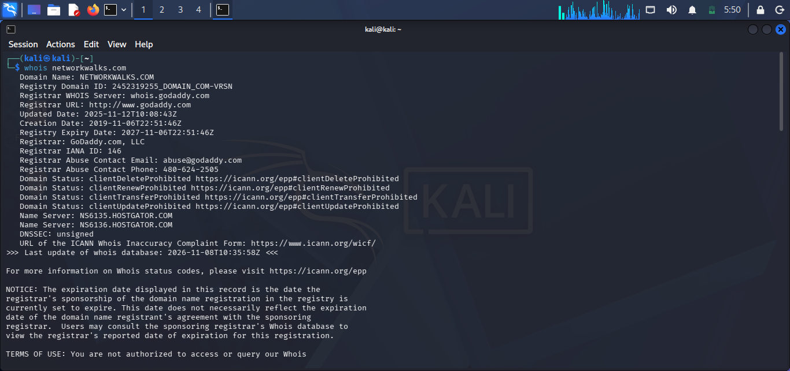
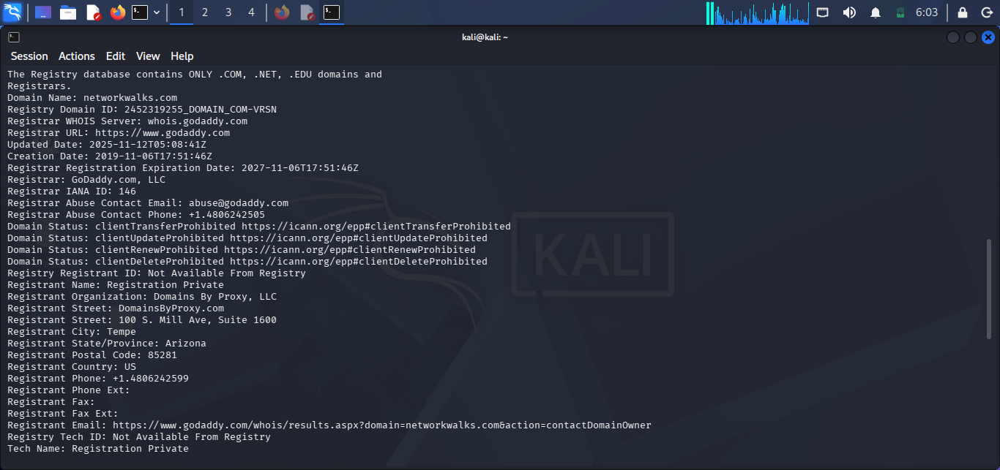
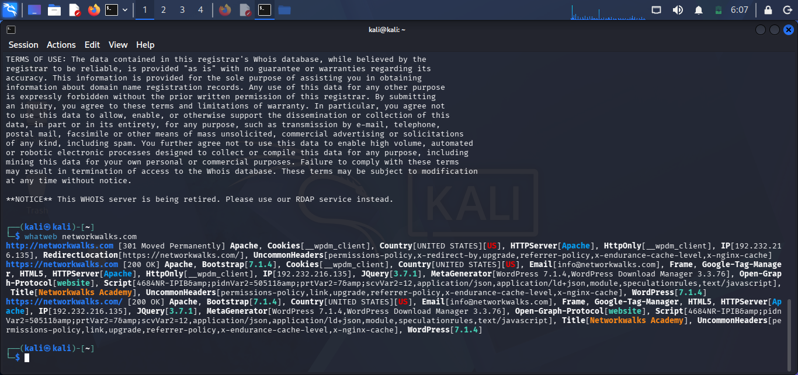
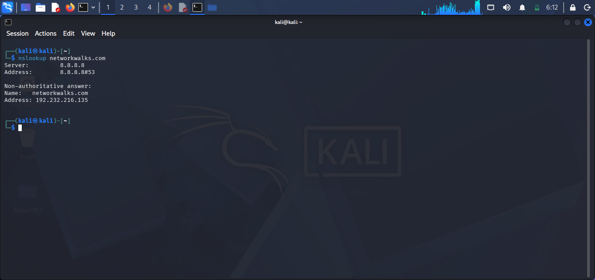
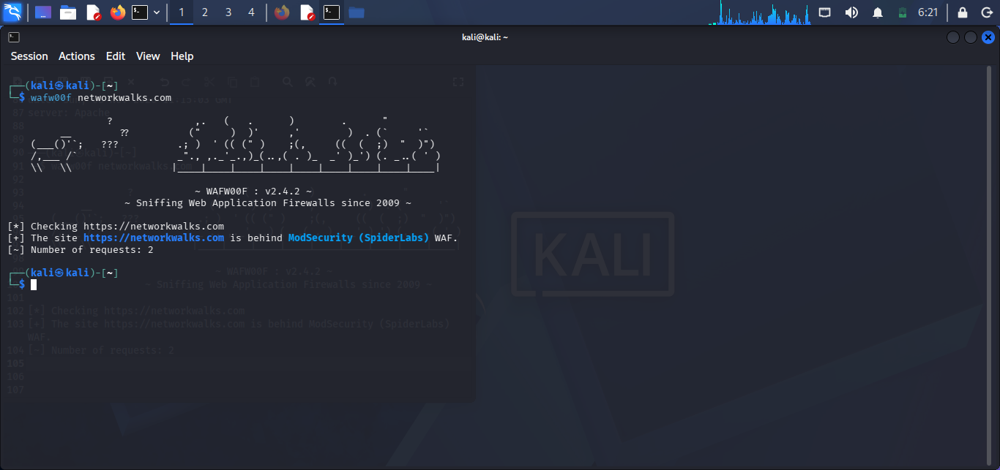
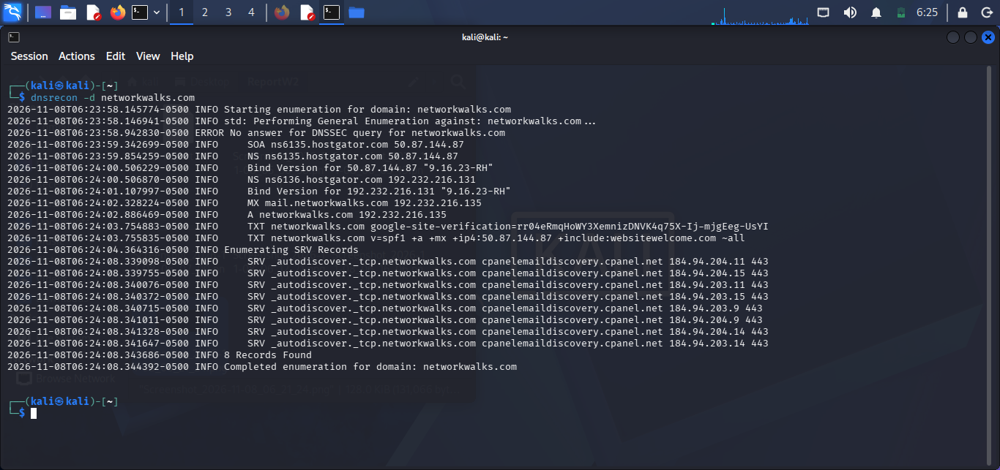
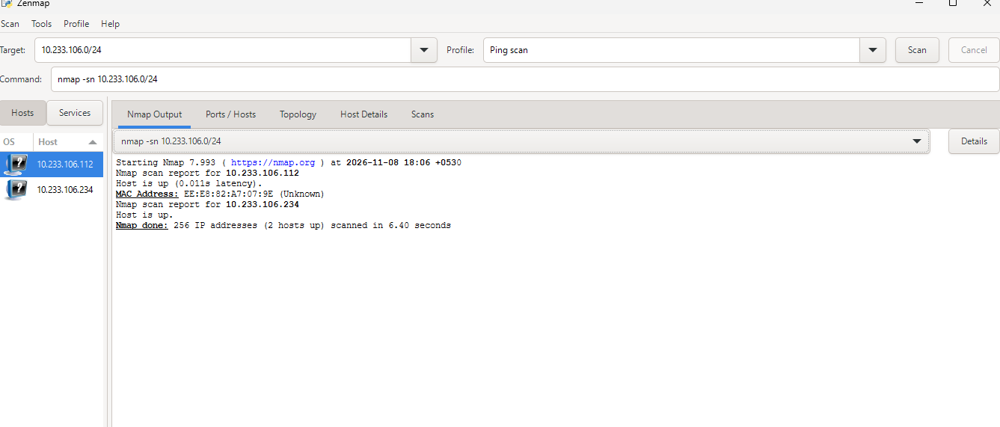

<div align="center">

# 🛡️ Penetration Testing Report

### Footprinting & Network Scanning Phases

**W2-PM-FINAL · Cybersecurity · Networkwalks**


</div>

---

## 📋 Report Details

| | |
|---|---|
| 👤 **Pentester** | Abhinav Sadanandan Nair |
| 🎓 **Program / Batch** | Cybersecurity & Ethical Hacking Internship, B084-Networkwalks |
| 📅 **Date** | 8 November 2026 |
| 📦 **Modules completed** | W2-PM1 (Multiple Kali Tools), W2-PM5 (Zenmap Scanning) |
| 🎯 **Targets** | 1. networkwalks.com (written permission already granted) <br> 2. My own local LAN |
| ✅ **Permission secured** | Yes |

---

## 📑 Table of Contents

- [Disclaimer](#-disclaimer)
- [Overview](#-overview)
- [Tools Used](#-tools-used)
- [Footprinting & Reconnaissance](#-1-footprinting--reconnaissance)
- [Network Scanning with Zenmap](#-2-network-scanning-with-zenmap)
- [Risk Analysis](#-3-risk-analysis)
- [Recommendations](#-4-recommendations)
- [Conclusion](#-5-conclusion)
- [Repository Contents](#-repository-contents)
- [Author](#-author)

---

## ⚠️ Disclaimer

> [!WARNING]
> All activities were performed **only on systems where written permission was granted, or on devices I own.**
> - **networkwalks.com**: written permission already granted by Networkwalks
> - **My own local LAN**: my own network
>
> This material is for **education and research purposes only**. Do not use anything here to break the law. Unauthorised access is a crime in most countries, even when nothing is damaged. Every action you take is your own responsibility.

---

## 🔭 Overview

This report shows how an attacker moves from **gathering public information** to **mapping live hosts** on a network.

| Phase | Description | Status |
|:-----:|-------------|:------:|
| **1** | Reconnaissance & Footprinting (networkwalks.com) | ✅ Completed |
| **2** | Scanning & Network Discovery (own LAN) | ✅ Completed |
| **3-5** | Later phases | 🚧 In progress |

---

## 🧰 Tools Used

| Tool | Purpose |
|------|---------|
| 🐧 Kali Linux & Windows | Operating systems used for the activities |
| 🔎 `whois` | Domain registration details (owner, dates, name servers) |
| 🕸️ `whatweb` | Fingerprint web technologies (server, CMS, plugins, IP) |
| 📍 `nslookup` | Resolve the domain name to its IP address |
| 📨 `curl -I` | Read the HTTP response headers |
| 🧱 `wafw00f` | Detect whether a Web Application Firewall is in use |
| 🌐 `dnsrecon` | Enumerate DNS records (NS, MX, SPF, TXT, SRV) |
| 🗺️ Zenmap (Nmap GUI) | Scan the subnet for live hosts, IPs and MAC addresses |
| 💻 Windows CMD | Local IP and MAC address identification |

---

## 🕵️ 1. Footprinting & Reconnaissance

**Target:** `networkwalks.com`

### 🔎 WHOIS

```bash
whois networkwalks.com
```

Registrar is GoDaddy.com, LLC. The domain was created on 2019-11-06 and expires on 2027-11-06. Name servers are `NS6135.HOSTGATOR.COM` and `NS6136.HOSTGATOR.COM`. DNSSEC is unsigned. The registrant is privacy-protected (Domains By Proxy, LLC).





### 🕸️ WhatWeb

```bash
whatweb networkwalks.com
```

Apache, **WordPress 7.1.4**, **WP Download Manager 3.3.76**, jQuery 3.7.1, Bootstrap and Google Tag Manager. Site title is "Networkwalks Academy".



### 📍 Nslookup

```bash
nslookup networkwalks.com
```

`networkwalks.com` resolves to `192.232.216.135`.



### 📨 Curl

```bash
curl -I https://networkwalks.com
```

HTTP/2 200 response. The headers expose the WordPress REST API endpoint `/wp-json/`, plus `x-nginx-cache`, `x-endurance-cache-level` and `server: Apache`.

### 🧱 Wafw00f

```bash
wafw00f networkwalks.com
```

The site is protected by a **ModSecurity (SpiderLabs)** WAF.



### 🌐 DNSRecon

```bash
dnsrecon -d networkwalks.com
```

SOA/NS records at hostgator.com, BIND version `9.16.23-RH`, MX `mail.networkwalks.com`, A record `192.232.216.135`, SPF and Google verification TXT records, and 8 cPanel SRV autodiscover records.



---

## 📡 2. Network Scanning with Zenmap

**Target:** `10.233.106.0/24` (own local network) · **Profile:** Ping scan

```bash
nmap -sn 10.233.106.0/24
```

### 📊 Scan Result

| | |
|---|---|
| 🛠️ Nmap version | 7.993 |
| 📅 Scan date | 2026-11-08 |
| 🔢 Addresses scanned | 256 |
| 🟢 Hosts up | **2** |
| ⏱️ Duration | 6.40 seconds |

| Host | Details |
|------|---------|
| `10.233.106.112` | Up (0.011s latency) · MAC `EE:E8:82:A7:07:9E` (vendor unknown) |
| `10.233.106.234` | Up · no MAC address displayed |



### 🗺️ Network Topology

The topology was generated in the Zenmap **Topology** tab with the legend enabled and saved as a PDF. It shows both hosts connected to `localhost`.

📎 [View topology PDF](Zenmap.pdf)

---

## 🚦 3. Risk Analysis

| # | Finding | Evidence | Potential Impact | Risk |
|:-:|---------|----------|------------------|:----:|
| 1 | Web technology info exposed | WhatWeb identified WordPress and WP Download Manager | Version info can help attackers choose software to target for review | 🟡 Medium |
| 2 | Server IP identifiable | Nslookup resolved `192.232.216.135` | Reveals network location of the web service | 🟢 Low |
| 3 | HTTP technical info exposed | Curl returned headers and exposed `/wp-json/` | Assists fingerprinting and further enumeration | 🟢 Low |
| 4 | WAF technology identifiable | Wafw00f identified ModSecurity | Reveals part of the security architecture | 🟢 Low |
| 5 | DNS infrastructure exposed | DNSRecon found NS, MX, TXT, SRV records | Helps build a broader infrastructure profile | 🟡 Medium |
| 6 | Live hosts visible on LAN | Zenmap identified two live hosts | Unknown or unauthorised devices may be present | 🟡 Medium |

> [!NOTE]
> These are **observations, not confirmed vulnerabilities**. Only information gathering and host discovery were performed. No exploitation or vulnerability validation took place. Further authorised testing would be needed to confirm any real vulnerability.

---

## ✅ 4. Recommendations

1. 🔍 Review the technology information that is publicly exposed (CMS, plugins, versions).
2. 🔄 Keep CMS platforms and plugins updated and check them against current advisories.
3. 📨 Review HTTP response headers and remove unnecessary technical information.
4. 🌐 Review DNS records regularly so only required records are public.
5. 🧱 Keep the WAF (ModSecurity) enabled and properly tuned.
6. 📡 Run regular internal network discovery scans.
7. 🕵️ Investigate any unknown device found during scanning.
8. 🗂️ Maintain up-to-date network topology and device documentation.
9. 🔐 Only perform reconnaissance and scanning with proper authorisation.

---

## 🎓 5. Conclusion

- 🔎 WHOIS, WhatWeb, Nslookup, Curl, Wafw00f and DNSRecon each reveal a different layer of information about a target.
- 🗺️ Zenmap quickly maps live hosts, IP and MAC addresses and network topology.
- 📚 A lot can be learned from public information before any exploitation is attempted.
- 📝 Findings must be documented clearly: what was done, what was found, what it means, the risk, and how to reduce it.
- ⚖️ Reconnaissance and scanning must always stay within an authorised scope.

---

## 📁 Repository Contents

```
.
├── README.md
├── W2-PM-FINAL_Report_Abhinav_Sadanandan_Nair.pdf   # Full report with evidence
├── s1.png                                           # WHOIS (1)
├── s2.png                                           # WHOIS (2)
├── s3.png                                           # WHOIS terms + WhatWeb
├── s4.png                                           # Nslookup
├── s6.png                                           # Wafw00f
├── s7.png                                           # DNSRecon
├── Screenshot_2026-11-08_180912.png                 # Zenmap ping scan
└── Zenmap.pdf                                       # Zenmap topology
```

📄 **[Read the full report (PDF)](W2-PM-FINAL_Report_Abhinav_Sadanandan_Nair.pdf)**

---

## 👤 Author

<div align="center">

**Abhinav Sadanandan Nair**
Cybersecurity & Ethical Hacking Internship · Networkwalks (Batch B084)

<sub>Course material by Waqas Karim CCIE, Cybersecurity Professional, Networkwalks</sub>

⭐ *If you found this useful, consider starring the repo!*

</div>
